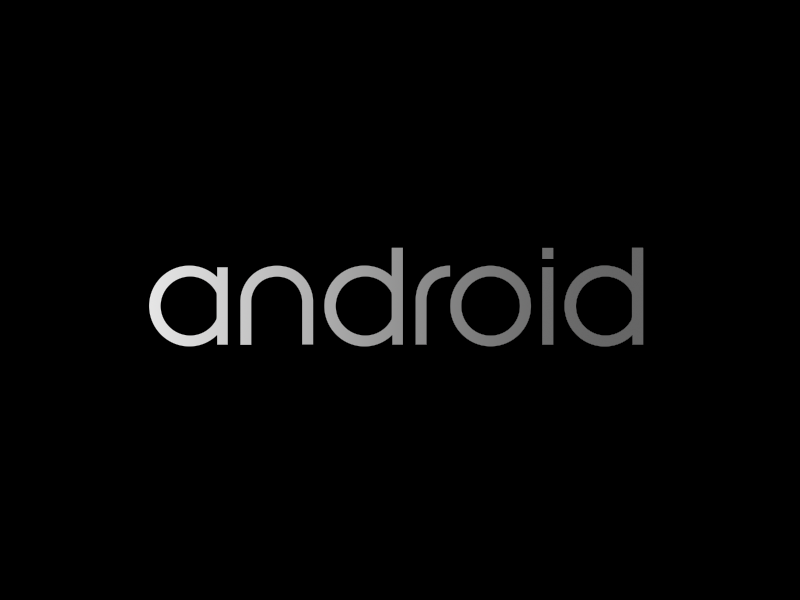
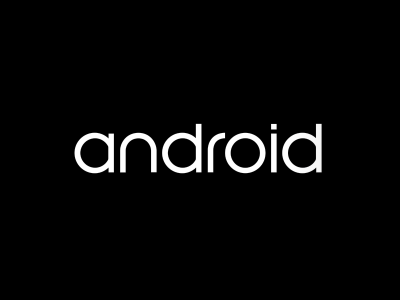

# reverseAndroid

Repositorio propio del **emulador Android de REVERSE**, con el modelo compacto XI/Ether original.

La base C68 completa procede de [REVERSE-PC, commit 37f5b461](https://github.com/guadalupejuan001-code/REVERSE-PC/tree/37f5b4610c5c31981e359fcf8fd0b303c14f01fd). Sus 870 archivos se conservan y se comprueban por hash en `state/upstream-snapshot.json`. Los flujos históricos están en `docs/upstream-workflows`; aquí solo se ejecutan los del emulador. La documentación anterior se conserva en `docs/REVERSE_PC_README.md`.

## Último resultado verificado

<!-- current-runtime -->
C86, etapa 3: **104.147.727.998 instrucciones** admitidas localmente. SystemServer sigue pendiente. El arranque completo y la interfaz utilizable siguen pendientes. SELinux permanece activo. El `init` original recuperó Zygote; [prueba del nuevo arranque](docs/evidence/c86/original-init-Zygote-recovery.json).
La etapa 2 coincide íntegramente entre la ejecución local y CI y tiene todas sus piezas conservadas. [Prueba](docs/evidence/c86/stage2-independent-local-CI-match.json); [estado actual](state/latest.json).
<!-- /current-runtime -->

### Historial conservado

La época corregida C76 ha admitido **92.547.727.998 instrucciones** en C83, con todas sus piezas conservadas. Las ejecuciones independientes C79 y C80 producen snapshots completos idénticos en 33, 35, 37, 39, 41, 43, 45, 47, 49, 51 y 53 mil millones, con tramos de 1 y 2 mil millones respectivamente. Se conservan la referencia original, el disco efectivo, XI/Ether y el reloj; C83 declara y valida la extensión CLZ descrita abajo. [Estado y piezas](state/latest.json); [comparación de estados completos](docs/evidence/c80/independent-partition-matches-through53B.json). Los dos estados C83 de antes y después de CLZ también cuentan con una comparación local íntegra; la recuperación de piezas de CI se identifica por separado.

C82 conservó tres fronteras válidas. Aplicó una sola vez el receptor y el primer fragmento de datos; está esperando su confirmación. La cuarta etapa encontró un bloqueo real del intérprete: `CLZ V0.4S,V0.4S`, opcode `0x6ea04800`, a las85.047.727.997 instrucciones. El candidato fallido queda como [diagnóstico](docs/evidence/c82/stage4-actual-CLZ-blocker.json); la continuación parte únicamente del último estado limpio de85 mil millones.

La [extensión CLZ explícita](docs/c83-clz-instruction.md) añade la operación a una copia de compilación y conserva los870 archivos de referencia. Ya pasó30.887 casos y1.112.149 comprobaciones, también con UBSan. La nueva versión del motor se identifica por separado. El disco, los códecs y los criterios de admisión y arranque se mantienen. La [comprobación independiente en hardware AArch64](docs/evidence/c83/authenticated-hardware-validation.json) pasó30.887 casos reales. CLZ también [se ejecutó correctamente en Android](docs/evidence/c83/actual-Android-CLZ-retirement.json), con comparación de todos los bytes de memoria y del estado de registros. C83 [reprodujo las dos fronteras completas](docs/evidence/c83/independent-local-CI-before-after-matches.json) con el binario independiente. La etapa3 también coincide íntegramente con la ejecución local, incluida toda la consola original. Android confirmó el primer fragmento y la preparación para el último; la transferencia continúa sin repetir entradas.

El servicio de luces **PID 652 está vivo y escucha realmente en VSOCK 6900**: sus descriptores y enlaces se verificaron con el BTF del kernel original. [Evidencia](docs/evidence/c76/stage16-lights-vsock-readonly.json). SurfaceFlinger 669 y bootanimation 858 ejecutan sus programas originales. SELinux permanece activo. Un [control aislado](docs/evidence/c80/jitfollow-control-stage1.json) comprobó que el hilo principal de ART vuelve a ejecutar tras ajustar el JIT 1156 de nice +19 a 0; la ejecución original seguía en la misma espera a los 57 mil millones. [C81](docs/c81-measured-art.md) continúa desde ese último estado principal con una sola entrada explícita, que vuelve a verificar el propietario, nombre y prioridad del hilo antes del ajuste. El ajuste ya fue confirmado por la respuesta real de Android y por la prioridad leída en el kernel de C81 a los 59 mil millones. A los 63 mil millones el hilo principal ya está ejecutando de nuevo; las etapas posteriores no repiten el comando.

**Todavía no hay arranque completo ni interfaz utilizable**. A los83 mil millones, el mismo SystemServer3386, UID1000, sigue vivo con55 hilos; [cuatro hilos están analizando paquetes reales](docs/evidence/c81/stage13-package-parsing.json). La parada de diagnóstico observada a los79 mil millones quedó conservada y el proceso volvió a ejecutar a los81, sin nuevas entradas en la continuación principal. La [lectura aislada de registros](docs/evidence/c81/completed-targeted-log-read-empty-result.json) terminó con éxito, sin mensajes para los PID consultados; no se atribuye una causa no observada. No se ha observado `sys.boot_completed=1`. La [pantalla auténtica revisada a las85.047.727.998 instrucciones](docs/evidence/c83/after-one-actual-frame-review.json) sigue mostrando el logo de arranque. La interfaz y su respuesta siguen pendientes.



La [integración aislada ABI3](docs/evidence/c82/prior-private-HAL-integration.json) ha pasado: OEM Lock y sensores abren tres canales reales y sus servicios originales están registrados en Binder. El programa invitado coincide con la compilación autenticada; SELinux está activo y la política cargada conserva el mismo hash. C82 entrega esa versión al último estado principal, manteniendo todo su disco y RAM; el estado aislado anterior se conserva como evidencia. [C80](.github/workflows/android-c80-continued-epoch.yml) sigue como referencia de la ejecución original anterior a C81.

El [ensayo aislado del compilador](.github/workflows/android-host-pgo-eval.yml) mide una compilación con perfil real desde una fuente fija: exige snapshots originales completos idénticos y una mejora repetida de al menos el 10 %. Los cuatro estados medidos coincidieron íntegramente. La mejora fue del 5,08%, por debajo del 10% requerido; [resultado auténtico](docs/evidence/c78/host-pgo-evaluation.json). La candidata no se adopta y sus estados no son autoridad de continuación.

[C75, etapa 6](https://github.com/guadalupejuan001-code/reverseAndroid/actions/runs/42098763084) conserva **`system_server` vivo, PID 3340**, a **88.895.950.532 instrucciones**, con checkpoint `7ecff7c2d460c582eeb3cbdf47fdd6686790cff2add75cd6c7437af7c9b9c3ec`. Pasó la [recuperación y admisión originales](docs/evidence/c75/independent-final-recovery.json). Android todavía no ha completado el arranque.

[C76](docs/c76-lights-boot-profile.md) investiga un fallo concreto del servicio de luces: falta su puerto VSOCK y el proceso aborta con permiso denegado. La corrección añade el puerto de arranque `6900`. Declara una nueva época de CPU y conserva **todo el disco efectivo de C75**, comprobado independientemente; mantiene kernel, CPIO, RAM, semilla, reloj y los 870 archivos originales. La nueva época debe volver a verificar init, arranque real, interfaz y respuesta a una entrada. No escribe propiedades Android en vivo.

[C74, etapa 6](https://github.com/guadalupejuan001-code/reverseAndroid/actions/runs/42088682642) verificó **`system_server` vivo, PID 3340**, en **82.895.950.532 instrucciones**. El checkpoint `a3d93b9a2a5665fc9bdbe09f5172cfbcd5314abdce82eb2cbb30557eb9442fd4` está conservado íntegramente en cuatro piezas. Los [seis snapshots completos](docs/evidence/c74/independent-final-boundaries.json) coinciden por SHA-256 con la ejecución local; también pasó la [admisión original de recuperación](docs/evidence/c74/independent-stage6-recovery-admission.json). SELinux sigue activo. El arranque completo y la interfaz continúan pendientes de verificar; C75 continuó desde esta frontera sin entradas UART nuevas.

La [lectura de los hilos](docs/evidence/c74/stage6-threads-summary.json) confirma que SystemServer pasó de 12 a 38 y después a **48 hilos**: aparecen ActivityManager, android.ui, android.display y PowerManager. La [última captura auténtica inspeccionada](docs/evidence/c74/stage6-original-scanout.png) sigue mostrando la animación de inicio. C73 queda conservado como [referencia anterior](docs/evidence/c73/independent-real-system-server.json).

[C72, etapas 1–6](https://github.com/guadalupejuan001-code/reverseAndroid/actions/runs/42062131978) completó su última frontera original en **70.895.950.532 instrucciones**, con checkpoint `18a5147749f4d13c776fee9bbb313fc20422357c46a9da6deaf2d8b450e1084b`. Los hashes de los seis snapshots completos coinciden con la ejecución local. En la etapa 4 también se compararon íntegramente **1.727.173.689 bytes**, que fueron idénticos. Los [registros independientes](docs/evidence/c72/independent-final-boundaries.json), las piezas y sus manifiestos quedan fijados en este repositorio. C70 sigue conservado como [referencia anterior](docs/evidence/c72/preserved-c70-before-c72.json).

En el checkpoint completo de C72, etapa 4 (**68.895.950.532** instrucciones), la espera del recolector terminó: el hilo principal de Zygote volvió a ejecutar y HeapTaskDaemon volvió a dormir. La [observación de solo lectura](docs/evidence/c72/gc-wait-released-stage4.json) está ligada al estado original `0c0a0aed62131eb50dbaf092e1c27ef34af1a10b3dc08578b0d8fa4e306e8d51`. Al cierre de la etapa 6, la lista verificada de Zygote contiene únicamente el hilo principal: el JIT que se ajustó ya no pertenece al grupo. C73 confirmó después `system_server`; C75 continúa con **cero entradas UART nuevas** hasta el arranque completo y la revisión de la interfaz. La lectura de los hilos reales de ART detectó que el comando de C71 devolvía éxito pero conservaba nice +19: en Toybox, `renice -n 0` suma cero. C71 se conserva como control. C72 corrige el comando a un incremento de −19, verifica primero la identidad y la prioridad reales del hilo JIT y conserva la entrada UART exacta. Las etapas solo continúan desde resultados plenamente admitidos y guardan cada checkpoint antes de avanzar.

El fotograma auténtico anterior de C69 mostró el **logo de inicio de Android en 800×600**. Se verificaron el ZIP, la pieza de transporte y el PPM original antes de inspeccionar la imagen. Esta observación no acredita el arranque completo.



## Frontera C68 conservada como respaldo

| Comprobación | Resultado C68, etapa 12 |
|---|---|
| Frontera independiente verificada | 64.295.950.532 instrucciones |
| Checkpoint SHA-256 | `f306e9ef430186b8839a75a4e29c4f57cda106f9b958ab0c5db10670c246b18e` |
| RAM lógica | 2 GiB |
| Formato compacto y decodificador originales | Conservados |
| `system_server` | Pendiente de verificar |
| `sys.boot_completed=1` | Pendiente de verificar |
| Contenido Android visible | Pendiente de verificar |

C68 queda como respaldo. El trabajo conserva el linaje del último checkpoint plenamente admitido. Los cambios de perfil que exigen otro arranque se declaran como nueva época y conservan íntegramente el disco efectivo. Los resultados posteriores se publican como artefactos y en el resumen de cada ejecución. Un check de migración correcto acredita integridad y avance; el arranque completo exige las comprobaciones originales de Android.

[C84](docs/c84-corrected-guest-shell.md) corrige el argumento de consola que bloqueó la activación C83. Conserva el último estado completo y el intento fallido; reintenta solo los dos comandos corregidos, con pruebas de su sintaxis interna real. La transferencia no se repite.

## Compilar y comprobar

Se requiere Linux, GCC, Python 3.11+, Node 24 y OpenSSL. La dependencia Mundo X se fija en `e2778d962af22f6f1a0794058dd4685fc2573966`, sin modificarla:

```bash
git clone https://github.com/guadalupejuan001-code/mundo-X.git deps/mundo-x
git -C deps/mundo-x checkout --detach e2778d962af22f6f1a0794058dd4685fc2573966
bash scripts/build-reverseandroid.sh
bash scripts/build-reverseandroid-epoch.sh
bash scripts/build-reverseandroid-clz.sh
bash scripts/build-reverseandroid-ic-ivau.sh
```

`state/latest.json` registra el último resultado verificado. `state/continuation.json` apunta a la última continuación y conserva desactivado el flujo histórico. `reverseandroid.yml` conserva la validación del motor importado; el flujo de corrección actual es `android-c85-ic-ivau-continuation.yml`. Cada resultado válido se conserva antes del siguiente paso. Los checkpoints se transportan en piezas de hasta 200 MiB, con manifiesto y SHA-256 por pieza.

Con `execute_on_push: false`, el flujo genérico no continúa el antiguo perfil C27. C85 recupera el último estado seleccionado y usa el binario validado `epoch-clz-ic`; su compilación local queda en `build/reverseandroid-ic-ivau/epoch-clz-ic`. La continuación histórica C83 usó `epoch-clz`. La compilación local lo deja en `build/reverseandroid-clz/epoch-clz`; `epoch` conserva el motor de referencia. El ejecutable histórico `native` conserva sus comprobaciones del perfil anterior. Los cambios de documentación no reinician el invitado.

Para recuperar un checkpoint fuera de Actions, reunir las piezas y su `manifest.json` en un directorio y ejecutar `python3 scripts/unpack-reverseandroid-checkpoint.py piezas destino-nuevo`. El proceso verifica las piezas, restaura los bytes originales y comprueba el hash completo. La admisión original del emulador sigue siendo obligatoria antes de ejecutar el estado.

Para un checkpoint de C76/C77, ejecutar `node --expose-gc tools/reverseandroid-epoch.mjs preflight destino-nuevo`. La continuación usa `tools/reverseandroid-epoch.mjs run`; conserva los decodificadores, las observaciones del kernel y las condiciones originales de arranque. El ejemplo original está en [la documentación de la época](docs/c76-lights-boot-profile.md). C83 añade la [extensión CLZ verificada](docs/c83-clz-instruction.md). Para continuar la campaña se recuperan también su prueba `c83-proof.json` y la transcripción completa autenticada: el receptor y los fragmentos ya aplicados permanecen en el estado guardado.

Se preservan XI/Ether, fondo cero, RVG/MXIM/RFP, la RAM lógica, el disco, la semilla temporal, 64 instrucciones por tick, comprobación de IRQ y las condiciones originales de aceptación. La migración C69 no introdujo entradas UART ni cambios de prioridades. El experimento C72 registra explícitamente un único comando real de consola que cambia nice +19 a 0 para el hilo JIT identificado; su entrada exacta y la prioridad leída en el kernel están en `state/experiments/c72-plan.json` y `docs/evidence/c72/effective-priority-first-stage.json`. Las etapas posteriores continúan sin repetir esa entrada.
